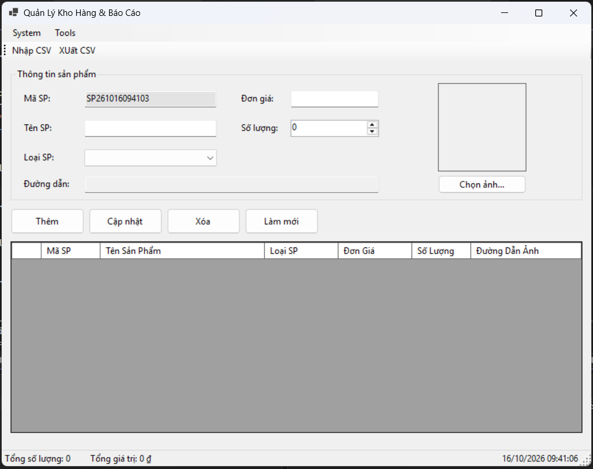

## THÔNG TIN SINH VIÊN

- ** Họ và tên: ** Lương Quốc Cường

- ** Mã số sinh viên :** 24810310195

- ** Lớp: ** D19CNPM3

- ** Tên môn học :** Lập trình .Net

- ** Tên bài tập :** [BÀI 2: PHẦN MỀM QUẢN LÝ KHO VÀ XUẤT BÁO CÁO TỔNG HỢP]

## KẾT QUẢ THỰC HÀNH

### 1. Ảnh màn hình Giao diện chính

### 2. Ảnh màn hình Chức năng thực thi / Kết quả

! [Thực thi chức năng](./screenshots/Result1.png)
! [Thực thi chức năng](./screenshots/Result2.png)
! [Thực thi chức năng](./screenshots/Result3.png)
! [Thực thi chức năng](./screenshots/Result4.png)
! [Thực thi chức năng](./screenshots/Result5.png)
! [Thực thi chức năng](./screenshots/Result6.png)
